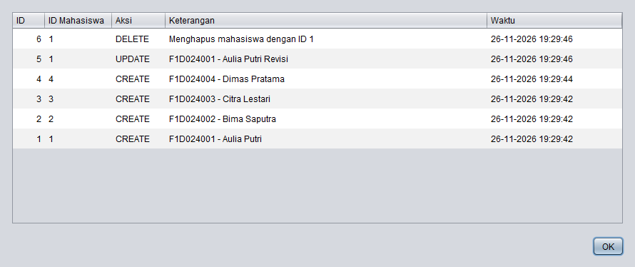

# CRUD Data Mahasiswa — Java Thread & Database

Studi kasus untuk **5C - Java Coding Practice - Thread and Database - 2026**, mata kuliah Pemrograman Berorientasi Objek.

| Identitas | Isi sebelum dikumpulkan |
| --- | --- |
| NIM | F1D02410080 |
| Nama | Muhammad Rifqy Habibi |
| GitHub Repository | https://github.com/ripkiiuu/TUGAS-THREADS |

## Tentang aplikasi

Aplikasi desktop **Java Swing** untuk mengelola data mahasiswa (NIM, nama, program studi, dan email). Semua pekerjaan database berjalan di thread `database-worker`, sedangkan perubahan GUI dilakukan di **Event Dispatch Thread (EDT)** melalui `SwingUtilities.invokeLater`.

**Database default: H2 berbasis file**, diakses melalui JDBC. Tidak membutuhkan instalasi server database. Data tersimpan pada `data/kampus.mv.db` dan tetap ada setelah aplikasi ditutup. **MySQL Connector/J juga disertakan** untuk menjalankan aplikasi dengan server MySQL bila diperlukan.

Fitur:
- **Create:** tambah mahasiswa; NIM harus unik.
- **Read:** tampilkan dan cari mahasiswa berdasarkan NIM, nama, atau program studi.
- **Update:** pilih baris tabel, ubah form, lalu simpan perubahan.
- **Delete:** hapus mahasiswa dengan dialog konfirmasi.
- **Audit log:** riwayat 100 transaksi terakhir, termasuk mahasiswa yang sudah dihapus.
- Validasi input, pesan kesalahan, indikator proses, dan tombol nonaktif selama pekerjaan database.
- Simulasi database lambat untuk memperlihatkan GUI yang tetap responsif.

> NIM dan nama pada screenshot adalah **data contoh**, bukan identitas pengumpul tugas.

## Kesesuaian dengan instruksi dosen

| Ketentuan | Implementasi |
| --- | --- |
| Connector `.jar` dalam project | `lib/h2-2.3.232.jar` dan `lib/mysql-connector-j-9.2.0.jar` |
| Import Referenced Libraries di VS Code | `.vscode/settings.json`: `java.project.referencedLibraries` |
| DAO dan Connection | `MahasiswaDao` dan `Database`, dengan koneksi baru untuk setiap operasi |
| PreparedStatement | Seluruh query CRUD, pencarian, dan audit menggunakan parameter `?` |
| Transaction | `setAutoCommit(false)`, `commit()`, dan `rollback()` di `inTransaction()` |
| ResultSet | Membaca daftar mahasiswa, generated key, dan riwayat transaksi |
| DB on a thread > invokeLater > GUI | `runDatabaseTask()` pada `MahasiswaFrame` |
| Klik > disable button > "Saving..." | Handler Tambah/Simpan, `setBusy(true)`, dan label status |
| README dan screenshot | Dokumen ini dan `docs/screenshots/` |

## 1. Menjalankan aplikasi

### Persyaratan

- **JDK 17 atau lebih baru**, bukan hanya JRE. Diuji dengan JDK 21 pada Windows.
- Windows PowerShell untuk script yang disediakan.
- Internet hanya diperlukan jika file JAR dalam `lib/` belum tersedia. Versi dan checksum dependency dikunci pada script.
- Tidak membutuhkan Maven, Gradle, atau server MySQL untuk mode default.

### Cara paling mudah

**Klik dua kali `run.bat`**. Script mengompilasi kode lalu membuka aplikasi.

Atau, dari terminal di folder project:

```powershell
powershell -NoProfile -ExecutionPolicy Bypass -File scripts/project.ps1 -Action run
```

Tabel database dibuat otomatis saat pertama kali dijalankan. Mulai dengan mengisi form; database aplikasi sengaja tidak diisi data contoh secara otomatis.

### VS Code

1. Buka **folder project ini**, bukan hanya satu file `.java`.
2. Pasang **Extension Pack for Java** dan pastikan VS Code memakai JDK 17+.
3. Di panel **JAVA PROJECTS > Referenced Libraries**, kedua file JAR seharusnya muncul otomatis melalui konfigurasi project. Jika belum muncul, gunakan tombol `+` dan pilih kedua JAR dari `lib/`.
4. Buka `src/kampus/App.java` lalu klik **Run** di atas `main()`, atau tekan F5 dan pilih **Jalankan CRUD Mahasiswa**.
5. Jangan menjalankan class `MahasiswaFrame` langsung; titik masuk aplikasi adalah `kampus.App`.

### Kompilasi manual (opsional)

Script `-Action build` menghasilkan `out/sources.txt` dan file `.class`:

```powershell
powershell -NoProfile -ExecutionPolicy Bypass -File scripts/project.ps1 -Action build
java -cp "out;lib/*" kampus.App
```

Untuk Linux/macOS dengan JDK 17+, file JAR yang sama dapat dipakai:

```bash
mkdir -p out
find src test -name '*.java' > out/sources.txt
javac -encoding UTF-8 --release 17 -cp 'lib/*' -d out @out/sources.txt
java -cp 'out:lib/*' kampus.App
```

Perintah Linux/macOS disediakan sebagai alternatif; pengujian langsung dilakukan di Windows.

## 2. Cara menggunakan dan mendemonstrasikan

1. **Tambah:** isi seluruh field, misalnya NIM `F1D024001`, nama `Aulia Putri`, program studi `Teknik Informatika`, email `aulia@kampus.ac.id`. Klik **Tambah**.
2. **Baca/cari:** isi kolom pencarian lalu tekan Enter atau **Cari**. Kosongkan pencarian dan klik **Cari** untuk menampilkan semuanya. **Muat ulang** mempertahankan filter saat ini.
3. **Ubah:** pilih satu baris tabel. Form terisi otomatis. Ubah data lalu klik **Simpan perubahan**. Klik **Form baru** untuk kembali ke mode tambah.
4. **Hapus:** pilih mahasiswa, klik **Hapus**, lalu konfirmasi **Yes**. Riwayat penghapusan tetap tersedia.
5. **Thread:** centang **Simulasi DB lambat (1,5 detik)**, lalu lakukan penyimpanan. Label menampilkan **Saving...**, form/tombol nonaktif, progress bar bergerak, dan jam **UI AKTIF** tetap berubah.
6. Setelah selesai, tombol aktif kembali dan tabel diperbarui. Simulasi memberi jeda pada setiap pekerjaan, termasuk pemuatan ulang, sehingga satu penyimpanan beserta refresh dapat membutuhkan sekitar 3 detik.
7. Klik **Riwayat transaksi** untuk melihat hasil CREATE/UPDATE/DELETE.
8. Coba menambahkan NIM yang sudah ada untuk melihat penanganan error tanpa menggandakan data.

Simulasi `Thread.sleep(1500)` hanya berjalan di worker dan **tidak digunakan untuk mengatur kebenaran transaksi**. Tanpa centang simulasi, tidak ada jeda buatan. Aplikasi menolak ditutup lewat tombol X selama pekerjaan berlangsung agar transaksi tidak dipotong.

## 3. Arsitektur dan penerapan thread

```text
App.main()
  └─ SwingUtilities.invokeLater(...)       [EDT]
      └─ MahasiswaFrame
          ├─ klik tombol, baca/validasi input, disable kontrol
          └─ ExecutorService.submit(...)  [database-worker]
              ├─ Database.open() → JDBC Connection
              ├─ MahasiswaDao → PreparedStatement → ResultSet
              ├─ commit / rollback
              └─ SwingUtilities.invokeLater(...) [kembali ke EDT]
                  └─ perbarui tabel/status dan aktifkan kontrol
```

Kode intinya berada di `MahasiswaFrame.runDatabaseTask()`:

```java
// Di EDT: nonaktifkan tombol dan tampilkan status.
setBusy(true);
status.setText(message); // "Saving..." saat menyimpan

// Di worker: jalankan pekerjaan database.
dbExecutor.submit(() -> {
    try {
        T result = work.call();
        SwingUtilities.invokeLater(() -> {
            setBusy(false);
            onSuccess.accept(result);
        });
    } catch (Exception exception) {
        // Implementasi lengkap: pulihkan kontrol dan tampilkan error lewat invokeLater.
    }
});
```

Cuplikan di atas disingkat untuk penjelasan; penanganan exception lengkap ada dalam source code.

**Alasan desain:**
- Mengikuti materi `Thread - 2025.pdf`, khususnya **SingleThreadExecutor** dan **ExecutorService and GUI** (halaman 18 dan 22).
- `newSingleThreadExecutor()` memakai satu worker yang dipakai ulang dan mengurutkan pekerjaan database.
- Worker tidak membaca atau mengubah komponen Swing. Input dibaca di EDT dan dikirim sebagai model `Mahasiswa` yang immutable.
- `Database.open()` sengaja menolak pemanggilan di EDT agar query tidak membekukan GUI.
- `Connection`, `PreparedStatement`, dan `ResultSet` ditutup dengan **try-with-resources**. Koneksi tidak dibagikan antar-thread.
- `shutdown()` menghentikan executor secara tertib saat jendela ditutup.
- Jam memakai `javax.swing.Timer`; callback-nya berjalan di EDT, bukan worker database.

### Transaksi yang benar-benar atomik

Setiap CREATE/UPDATE/DELETE menjalankan **dua perubahan dalam koneksi dan transaksi yang sama**:

```text
setAutoCommit(false)
  1. INSERT / UPDATE / DELETE tabel mahasiswa
  2. INSERT tabel audit_log
  → keduanya berhasil: COMMIT
  → salah satu gagal: ROLLBACK seluruh perubahan
```

Misalnya, bila INSERT mahasiswa berhasil tetapi INSERT audit gagal, mahasiswa tersebut **tidak boleh tersimpan**. Kondisi ini diuji otomatis, termasuk rollback UPDATE dan DELETE. Inisialisasi tabel (DDL) terpisah dari transaksi CRUD karena MySQL melakukan implicit commit pada DDL.

Pencarian menggunakan `PreparedStatement`, bukan penggabungan input pengguna ke SQL. Karakter `%`, `_`, dan `!` di-escape agar pencarian memperlakukannya sebagai teks biasa.

## 4. Struktur project

```text
.
├── src/kampus/
│   ├── App.java                       # Titik masuk, membuat GUI di EDT
│   ├── db/
│   │   ├── ConnectionFactory.java     # Abstraksi pembuat koneksi
│   │   └── Database.java              # Konfigurasi, JDBC, inisialisasi schema
│   ├── model/
│   │   ├── Mahasiswa.java             # Model dan validasi input
│   │   └── AuditLog.java              # Model riwayat transaksi
│   ├── dao/MahasiswaDao.java          # CRUD, pencarian, transaksi, audit
│   └── ui/MahasiswaFrame.java         # Swing GUI dan worker database
├── test/kampus/
│   ├── DaoIntegrationTest.java        # Pengujian JDBC, rollback, concurrency, persistensi
│   └── GuiIntegrationTest.java        # Pengujian handler GUI dan capture screenshot
├── lib/                              # Dua JDBC connector JAR
├── sql/mysql.sql                     # Schema untuk pilihan MySQL
├── scripts/project.ps1               # Build / run / test / gui-test
├── docs/screenshots/                 # Bukti hasil GUI
├── .vscode/                          # Referenced Libraries dan launch configuration
├── db.properties.example             # Contoh konfigurasi; tanpa password sungguhan
├── run.bat
└── README.md
```

Folder `out/`, `data/`, dan konfigurasi pribadi `db.properties` tidak diunggah ke GitHub. Dua PDF materi asli tetap dipertahankan di folder kerja dan diabaikan oleh Git; tidak dibutuhkan untuk menjalankan aplikasi.

## 5. Opsi menggunakan MySQL

**Lewati bagian ini jika memakai H2 default.** Server MySQL tidak terpasang di lingkungan pengujian, sehingga pengujian otomatis dan screenshot menggunakan H2, bukan server MySQL. Mode kompatibilitas H2 tidak berarti kedua engine identik.

1. Siapkan dan jalankan **MySQL 8+**.
2. Jalankan `sql/mysql.sql` melalui MySQL CLI atau menu SQL/import phpMyAdmin. Jangan hanya menyalin JAR; MySQL tetap membutuhkan server yang aktif.
3. Buat user database sesuai komentar SQL, atau gunakan akun lokal yang sudah memiliki hak untuk database tersebut.
4. Salin konfigurasi contoh:

   ```powershell
   Copy-Item db.properties.example db.properties
   ```

5. Ganti **tiga baris aktif** pada `db.properties` dengan konfigurasi lokalmu:

   ```properties
   db.url=jdbc:mysql://localhost:3306/thread_database?connectTimeout=5000&socketTimeout=10000&connectionTimeZone=Asia/Jakarta
   db.user=thread_app
   db.password=PASSWORD_LOKALMU
   ```

6. Jalankan kembali `run.bat`. Label database akan menampilkan **MySQL**.

`mysql-connector-j-9.2.0.jar` sudah tersedia di `lib/` dan classpath. JDBC 4 menemukan driver otomatis, sehingga `Class.forName(...)` tidak wajib. Aplikasi memakai protokol JDBC klasik, bukan MySQL X DevAPI.

**Jangan mengunggah password atau `db.properties` ke GitHub.** Untuk kembali ke H2, pindahkan/rename konfigurasi pribadi tersebut atau ubah URL dan kredensialnya sesuai contoh H2.

## 6. Pengujian

### Pengujian DAO/JDBC

```powershell
powershell -NoProfile -ExecutionPolicy Bypass -File scripts/project.ps1 -Action test
```

Hasil: **59 pemeriksaan lulus**, meliputi:
- Validasi input, generated key, CREATE/READ/UPDATE/DELETE, dan pencarian.
- NIM duplikat dan upaya SQL injection pada pencarian.
- Commit data beserta audit; rollback nyata ketika statement audit sengaja digagalkan.
- Penolakan update/delete ID yang sudah tidak ada.
- 24 pekerjaan dari empat thread tanpa kehilangan data dan audit.
- Penolakan koneksi database di EDT.
- Persistensi database file setelah semua koneksi ditutup dan database dibuka ulang.

### Pengujian GUI dan screenshot

```powershell
powershell -NoProfile -ExecutionPolicy Bypass -File scripts/project.ps1 -Action gui-test
```

Hasil: **14 pemeriksaan lulus**. Tes membuka GUI, menjalankan handler tombol sebenarnya, memeriksa status dan kontrol saat saving, menguji update setelah sorting, pencarian, konfirmasi hapus, riwayat, serta pemulihan UI setelah NIM duplikat.

Tes menggunakan database uji terpisah dan **tidak menyentuh `data/kampus.mv.db` atau konfigurasi pribadimu**. Log exception duplikat pada tes GUI **disengaja**, lalu tes harus berakhir dengan `PASS: 14 ...`. Pengujian GUI membutuhkan sesi desktop, tidak dijalankan dalam mode headless.

Screenshot dibuat langsung dari komponen GUI aplikasi yang berjalan melalui `printAll()` di EDT, tanpa mengambil jendela aplikasi lain pada desktop. Ini bukan mockup. Tes `gui-test` akan memperbarui empat gambar berikut.

## 7. Screenshot

### Daftar mahasiswa setelah CREATE


### Worker berjalan: Saving..., kontrol nonaktif, GUI tetap responsif


### Hasil UPDATE dan pencarian


### Riwayat CREATE, UPDATE, dan DELETE



## 8. Menyiapkan pengumpulan GitHub

1. Isi NIM dan nama asli pada tabel identitas di atas.
2. Buat repository GitHub milikmu, misalnya `pbo-thread-database`.
3. Upload source code, folder `lib/`, `.vscode/`, `sql/`, `scripts/`, `test/`, `docs/`, `run.bat`, `db.properties.example`, `.gitignore`, dan `README.md`.
4. Jangan upload `out/`, `data/`, password, atau PDF materi dosen. Jika memakai `git add .`, `.gitignore` sudah mengatur pengecualian tersebut.
5. Pastikan screenshot tampil pada README di halaman GitHub. Isi URL repository pada identitas README.
6. Kirim **satu balasan** pada diskusi dengan format dosen:

   ```text
   NIM: F1D02410080
   Name: Muhammad Rifqy Habibi
   GitHub Repository Link: https://github.com/ripkiiuu/TUGAS-THREADS
   ```

**Batas waktu pada instruksi tugas: 27 November 2026, pukul 10.00.** Repository remote dan balasan forum tidak dibuat/dikirim otomatis oleh project ini.

## Troubleshooting singkat

| Masalah | Solusi |
| --- | --- |
| `java`/`javac` tidak ditemukan | Pasang JDK 17+ dan perbaiki `PATH`/`JAVA_HOME` |
| `UnsupportedClassVersionError` | Gunakan runtime Java 17+; pastikan `java` dan `javac` menunjuk instalasi yang sesuai |
| `No suitable driver` | Jalankan lewat script atau periksa kedua JAR dalam Referenced Libraries/classpath |
| `Database may be already in use` | Tutup instance aplikasi lain yang membuka file H2 yang sama |
| Koneksi MySQL gagal | Periksa server, port, database, user/password, dan hak akses; klik Muat ulang untuk mencoba lagi |
| Data baru tidak terlihat | Kosongkan pencarian lalu klik Cari; filter tidak dihapus otomatis setelah penyimpanan |
| Tombol Tambah nonaktif setelah memilih baris | Klik Form baru untuk keluar dari mode edit |

## Referensi

- Materi dosen: `Thread - 2025.pdf` dan `Contoh Kode Thread.pdf`.
- [Oracle — Concurrency in Swing](https://docs.oracle.com/javase/tutorial/uiswing/concurrency/).
- [Oracle — JDBC Transactions](https://docs.oracle.com/javase/tutorial/jdbc/basics/transactions.html).
- [H2 Database](https://h2database.com/html/main.html).
- [MySQL Connector/J](https://dev.mysql.com/doc/connector-j/en/).
- Asal unduhan dan informasi lisensi dependency: [lib/README.md](lib/README.md).
