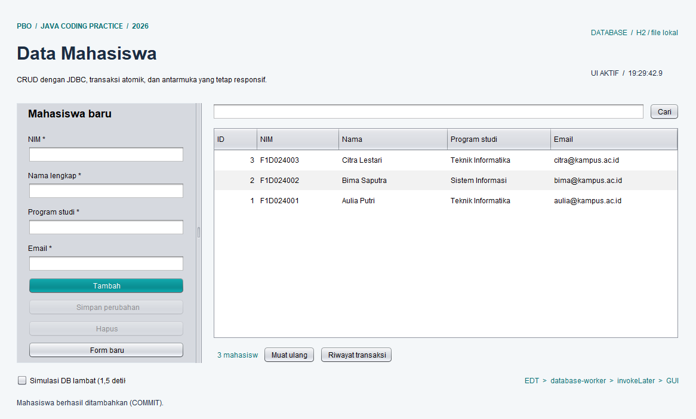
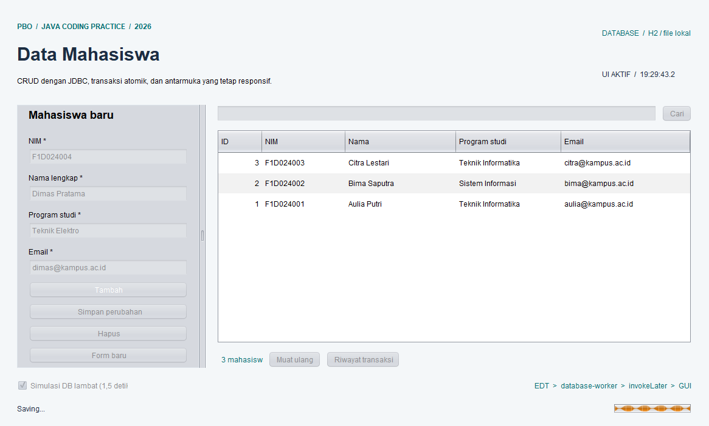
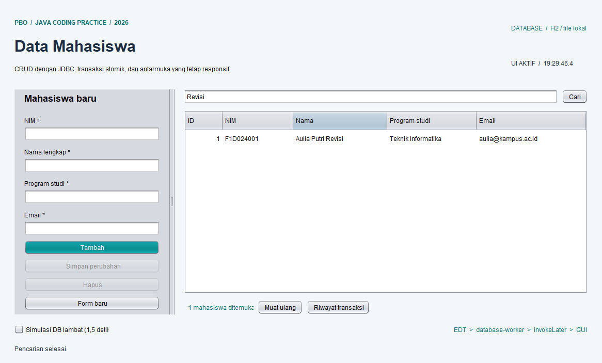

# CRUD Mahasiswa

- Nama: Muhammad Rifqy Habibi
- NIM: F1D02410080

Tugas Pemrograman Berorientasi Objek untuk materi Thread dan Database.

Aplikasi desktop Java Swing untuk mengelola NIM, nama, program studi, dan email mahasiswa. Data disimpan di database melalui JDBC.

## Fitur

- Tambah, tampilkan, ubah, dan hapus data mahasiswa.
- Pencarian berdasarkan NIM, nama, atau program studi.
- Validasi input dan pengecekan NIM duplikat.
- Riwayat perubahan data.
- Simulasi database lambat untuk mencoba proses penyimpanan dengan thread.

## Menjalankan

Gunakan JDK 17 atau lebih baru, lalu klik dua kali `run.bat` di Windows. Script akan mengompilasi kode dan membuka aplikasi.

Untuk menjalankan dari terminal:

```powershell
powershell -NoProfile -ExecutionPolicy Bypass -File scripts/project.ps1 -Action run
```

Di VS Code, buka folder project lalu jalankan `src/kampus/App.java`. Konfigurasi Referenced Libraries sudah mengarah ke file JAR di folder `lib/`.

Isi form dan klik **Tambah** untuk menyimpan mahasiswa baru. Untuk mengubah atau menghapus data, pilih baris pada tabel. Tombol **Form baru** mengosongkan form dan mengembalikannya ke mode tambah.

## Thread dan database

Operasi database berjalan melalui `ExecutorService` di thread `database-worker`. Setelah selesai, `SwingUtilities.invokeLater()` memperbarui tabel dan status di Event Dispatch Thread (EDT).

Selama penyimpanan, tombol dan form dinonaktifkan serta status menampilkan `Saving...`. Opsi **Simulasi DB lambat** memberi jeda 1,5 detik pada worker. Jam pada GUI tetap berjalan selama proses tersebut.

Query berada di `MahasiswaDao` dan menggunakan `PreparedStatement` serta `ResultSet`. Perubahan data mahasiswa dan pencatatan riwayat dilakukan dalam satu transaksi. Jika keduanya berhasil, transaksi di-commit. Jika salah satunya gagal, perubahan di-rollback.

Database default menggunakan H2, jadi tidak perlu memasang server database. File data dibuat otomatis di `data/kampus.mv.db` dan tetap tersimpan setelah aplikasi ditutup.

Untuk memakai MySQL, jalankan `sql/mysql.sql`, salin `db.properties.example` menjadi `db.properties`, lalu sesuaikan URL JDBC, username, dan password. Driver MySQL sudah ada di `lib/`. Pengujian project menggunakan H2; koneksi ke server MySQL belum diuji.

## Pengujian

Tes DAO dan database:

```powershell
powershell -NoProfile -ExecutionPolicy Bypass -File scripts/project.ps1 -Action test
```

Tes GUI:

```powershell
powershell -NoProfile -ExecutionPolicy Bypass -File scripts/project.ps1 -Action gui-test
```

Hasil pengujian: 59 pemeriksaan DAO/database dan 14 pemeriksaan GUI lulus. Tes mencakup CRUD, rollback, NIM duplikat, penyimpanan file, dan respons GUI saat worker berjalan. Database pengujian terpisah dari data aplikasi.

## Screenshot

Daftar mahasiswa:



Proses penyimpanan:



Hasil perubahan dan pencarian:



Riwayat transaksi:


